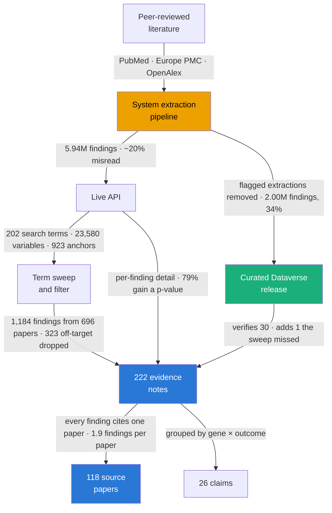

# 👋 Welcome to the System Malaria vault

> [!info] One-line purpose
>
> **A discourse graph of published quantitative evidence on antimalarial drug-resistance markers**, extracted from the System Public Graph, where every finding traces back to a PubMed record and every count is reproducible from the scripts in `scripts/`.

---

## 🎯 Purpose

This vault supports **Build Challenge 3** of the System Public Challenge (14 November 2026): *when does new evidence change the picture for a malaria drug resistance marker?* The deliverable is a prototype that alerts a researcher when published evidence on a marker they track has meaningfully moved.

The System Public Graph holds millions of quantitative findings extracted from peer-reviewed research, but it holds them as **one free-text variable per paper** rather than as canonical entities. So before you can detect that evidence has changed, you have to reconstruct what the evidence *is*. That reconstruction is what this vault contains.

It follows the node conventions of the **living-synthesis** vault (`~/Documents/living-synthesis`, a separate vault), adapted from PDF extraction to graph extraction.

> [!warning] This vault is machine-generated and unverified
>
> Every node carries `NodeFormality: draft` and `human_reviewed: no`. The counts are only as good as the grouping regexes in `scripts/build_vault.py`, and System documents a ~20% extraction error rate on the underlying API. Read [[CVT - Roughly 20 percent of API associations are mis-extracted]] before citing anything.

---

## 🧱 Four node types

| Icon | Type         | Prefix | Role                                                               |
| :--: | ------------ | ------ | ------------------------------------------------------------------ |
|  ❓   | **Question** | `QUE`  | What the challenge and we are asking                               |
|  💡  | **Claim**    | `CLM`  | Aggregations over findings — marker × outcome theme                |
|  🔬  | **Evidence** | `EVD`  | An association from the graph: two variables, a statistic, a study |
|  ⚠️  | **Caveat**   | `CVT`  | Limits on what the evidence can support                            |

> [!example] How they connect
>
> ```
> ❓ QUE: How can we tell when new research changes what is known about a
>        drug-resistance gene?
>     ↳ 💡 CLM: Mutations in Pfkelch13 are associated with higher rates of
>              antimalarial treatment failure, though a minority of findings disagree
>         ↳ 🔬 EVD: artemisinin-resistant K13 (Pfkelch13) mutants carried 32 times
>                  the risk of recrudescence - @duru2015
>             ↳ ⚠️ CVT: The graph records no effect direction
> ```
>
> Every title is written to be read on its own, without opening the note: it leads with the
> number, names both things being related, expands the acronyms, and credits the study.

Claims are **directional assertions**, in the living-evidence-synthesis style — things someone could disagree with, such as *"Mutations in PfCRT are associated with higher rates of antimalarial treatment failure, consistently across studies."* The direction comes from the majority sign of the underlying findings measured against each statistic's null value, and the trailing qualifier reports how much they agree. Every claim lists its **contradicting** evidence alongside its supporting evidence, because a claim that hides disagreement is not worth making.

What a claim never asserts is a **magnitude**. The findings use incompatible statistic types that cannot be pooled, so a claim commits to a direction and its consistency, nothing more.

Each evidence node is framed with **PICOST** — Population, Intervention, Comparator, Outcome, Setting, Timeframe — filled only where the record supports it. In 126 of 222 findings the graph does not make clear which variable is the exposure and which the outcome, and those notes say so explicitly rather than guessing.

---

## 🗺️ How to navigate

> [!tip] Four ways in
>
> 🟦 **Top-down.** Open [[DGRAPH]] — a nested index of every QUE → CLM → EVD path.
>
> 🟩 **Question-first.** Browse `questions/`. Five questions, each listing the claims beneath it and the caveats on any answer.
>
> 🟨 **Paper-first.** Browse `source/@<surname><year>.md`, e.g. `@bonnington2017`. One stub per study, **citation data only** — authors, journal, date, DOI, PubMed ID, who was studied. No article text; follow the DOI.
>
> 🟦 **Brief first.** Open [[ABSTRACT]] — a 500-word executive summary in plain language, written for a reader with no biomedical or statistical background, with the jargon explained in footnotes.
>
> 🟧 **Audit-first.** Open [[EVAL]] — one section per check (open data, open code, open access, retractions, errata, comments, social sentiment), each with the quoted text it was read from and a full APA 7th reference list.
>
> 🟥 **Caveat-first (recommended).** Browse `caveats/`. Seven caveats, and they are the most load-bearing content in the vault. The honest story of this dataset is in its limits.

---

## 📊 What is actually in here

| | Count |
| --- | --- |
| Evidence nodes (findings) | 222 |
| Source studies | 118 |
| Claim nodes | 26 |
| Questions | 5 |
| Caveats | 7 |
| Publication window | 1987–2025 |

Findings per marker: Pfmdr1 89 · PfCRT 77 · PfDHFR 30 · PfDHPS 30 · Pfkelch13 18 · other markers 6 · plasmepsin 1.

Of the 221 findings, **30 are confirmed against System's curated dataset** and 191 are not — see [[CVT - The curated Dataverse deposit holds almost no resistance evidence]].

Note the shape of that list. **Pfkelch13 has the fewest findings and matters most** — it tracks artemisinin partial resistance, the reason this challenge exists. See [[CVT - Pfkelch13 is the most important marker and the least covered]].

---

## 🧬 Where this evidence came from



### Two sources, used for different jobs

**The live API is where the evidence comes from.** A 202-term sweep of variable names found 23,580 variables, of which 923 were resistance-marker anchors. Pulling every finding attached to those anchors gave 1,184, and filtering for malaria relevance left the 222 notes in this vault. A
second pass fetched each finding individually, because the list endpoint withholds p-values and
confidence intervals — that pass is why **176 of 222 notes (79%) carry a p-value** and **105
(47%) carry a confidence interval**.

**The curated Dataverse release is where the evidence gets checked.** System states that roughly
20% of API findings are misread from their source papers, and that the ones it had flagged were
removed from this release. So presence in it is the best available signal that a number was read
correctly. A regex sweep of all 1,999,877 rows in that release turned up just **25** marker
findings, against 1,184 from the API — it cannot serve as the source of evidence here. What it
does is confirm **30 of 222 notes (14%)**, and contribute exactly **one** finding the API sweep
never saw.

Every evidence note states which sources it drew on, and the split across the vault is:

| Data source | Notes | Share |
|---|---|---|
| API list + API detail | 191 | 86% |
| API list + API detail + Dataverse release | 30 | 14% |
| Dataverse release only | 1 | <1% |

### Were the source papers sound?

All 117 source papers were screened on 14 November 2026 against **PubMed's CommentsCorrections
records** and **Crossref's update metadata**, which is where retractions, errata and expressions
of concern are formally recorded, and which now carries the Retraction Watch data Crossref hosts.

**None is retracted and none carries an expression of concern.** Four have a published erratum,
and eight attracted formal published comments — including three of the most consequential
artemisinin-resistance papers in the set. Every source note states its result, and findings from
a corrected paper carry a warning, because System extracted the statistic from the original
article and the graph records nothing about corrections.

**PubPeer was checked, and found nothing.** All 117 papers were queried through the API
published in The PubPeer Foundation's own browser extension, twice — once by DOI and once by
PubMed ID. **Not one has a PubPeer entry.** That zero was verified rather than assumed: a known
heavily-commented retraction placed inside a full 20-DOI batch alongside 19 of our papers came
back with its 34 comments, while ours returned nothing.

Read that silence carefully. PubPeer's attention concentrates on high-profile papers and on
suspected image or statistics problems, largely in cell biology and psychology. A specialist
malaria-genotyping literature having no threads most plausibly means nobody has looked, not that
nothing is wrong. See [[CVT - What the post-publication screen covers and what it cannot]].

### What this means for reading a note

**A note sourced from the API alone is not wrong — it is unchecked.** System's documentation says to discard findings absent from the curated release, but taken literally that would throw away 86% of this vault, and absence reflects the release's much narrower scope as much as it reflects data quality. So the vault keeps those findings and labels them, rather than deleting them or quietly trusting them. The **In curated release** row in every note's Statistic table is the
field to look at before citing a number.

**Publication year comes from outside the graph entirely.** The System Public Graph records no
dates, so every year in this vault was fetched from PubMed using the PubMed identifier attached
to each finding, as were the first-author surnames behind the `@surnameYEAR` citekeys. Note that
publication year is not the year the parasites were collected — the graph holds nothing about
fieldwork dates, so a 2024 paper may well describe 2019 samples.

---

## 🔁 Reproducing this vault

```bash
cd ~/system-public-challenge
python3 harvest.py --probe        # confirm the API and its field shapes
python3 harvest.py --stage 1      # sweep variable names, 202 terms
python3 harvest.py --stage 2      # concepts and grounding
python3 harvest.py --stage 3      # pull associations
python3 harvest.py --stage 4      # studies, then PubMed dates
python3 scripts/build_vault.py    # regenerate every node in this vault
```

Needs `SYSTEM_API_KEY` in `~/system-public-challenge/.env`. Roughly 3,700 API requests against a 10,000/day limit.

See [[Skill]] for the method, [[EVAL]] for the verbatim evidence behind every openness and
integrity check with APA 7th citations, `LOG.md` for what happened, and `History.md` for what
changed.

---

## 🙏 Credits

Built with the System Public Graph (July 2026 release, CC BY-NC 4.0). Publication dates from PubMed E-utilities. Challenge set by Roberto Amato, PATH.

Anything derived from Public Graph data carries the graph's CC BY-NC licence.
